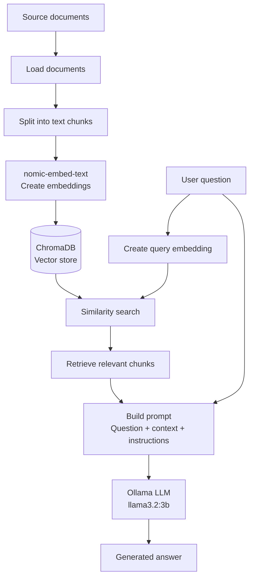
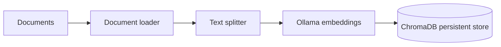
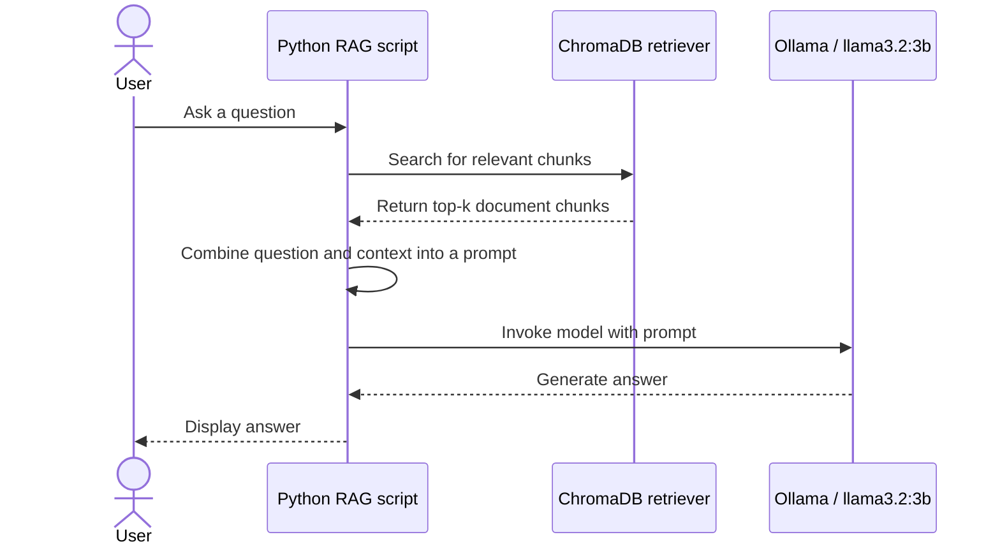

# Local RAG with LangChain, Ollama and ChromaDB

A local Retrieval-Augmented Generation (RAG) project built with Python, LangChain, Ollama and ChromaDB. It demonstrates how to ingest documents, retrieve relevant text chunks using semantic search, and use a local large language model (LLM) to answer questions grounded in the retrieved context.

> **Note:** This repository contains multiple scripts for ingestion, retrieval and history-aware question answering. Follow the script-specific notes below and adjust commands if your local filenames or setup differ.

## Table of Contents

- [Overview](#overview)
- [How RAG Works](#how-rag-works)
- [Architecture](#architecture)
- [Technology Stack](#technology-stack)
- [Repository Structure](#repository-structure)
- [Prerequisites](#prerequisites)
- [Installation](#installation)
- [Run the Project](#run-the-project)
- [How the Main Components Work](#how-the-main-components-work)
- [Configuration](#configuration)
- [Troubleshooting](#troubleshooting)
- [Limitations and Future Improvements](#limitations-and-future-improvements)

## Overview

Retrieval-Augmented Generation combines information retrieval with text generation:

1. Documents are loaded and split into smaller chunks.
2. An embedding model converts chunks into vectors.
3. ChromaDB stores the vectors and associated text.
4. A user's question is embedded and used to retrieve relevant chunks.
5. A local LLM receives the question and retrieved context and generates a response.

This approach helps an LLM answer questions using information from a selected document collection, rather than relying only on its pretrained knowledge.

## How RAG Works



## Architecture

The project separates the indexing (ingestion) process from the question-answering (retrieval and generation) process.

### Ingestion pipeline



### Question-answering pipeline



For history-aware question answering, the LLM can also rewrite a follow-up question into a standalone search query before retrieval.

## Technology Stack

| Technology | Purpose |
|---|---|
| Python | Application and pipeline code |
| LangChain | Components and orchestration for loading, retrieval, messages and model calls |
| Ollama | Runs the embedding and language models locally |
| `nomic-embed-text` | Creates embeddings used for semantic search |
| `llama3.2:3b` | Generates answers from the question and retrieved context |
| ChromaDB (`langchain-chroma`) | Persists document chunks and vectors and supports similarity search |
| `python-dotenv` | Loads environment variables from a `.env` file when configured |

## Repository Structure

The repository currently includes the following main files and folders:

```text
RAG/
├── db/
│   └── chroma_db/                 # Persistent ChromaDB data (local generated data)
├── docs/                          # Project documentation
├── history_aware_generation.py    # Chat history-aware question answering
├── ingestion_pipeline.py          # Document loading, chunking and indexing
├── retrieval_pipeline.py          # Retrieve context and generate an answer
├── test.py                        # Experimentation or testing script
├── .gitignore
└── README.md
```

The exact contents of `docs/` and the behavior of `test.py` depend on the current repository version.

**Database note:** ChromaDB's local persistent store may contain `chroma.sqlite3` and collection/index directories. These are generated database files, not source code. If the vector store can be recreated from source documents, consider excluding the database from Git and documenting how to rebuild it. Do not commit private or licensed source documents unless you have permission to share them.

## Prerequisites

Install the following before running the project:

- Python 3.9 or a compatible version supported by your installed packages
- [Ollama](https://ollama.com/)
- Git
- A terminal and code editor

Check the installations:

```bash
python3 --version
git --version
ollama --version
```

## Installation

### 1. Clone the repository

```bash
git clone https://github.com/shrudh14007/RAG.git
cd RAG
```

### 2. Create and activate a virtual environment

On macOS or Linux:

```bash
python3 -m venv venv
source venv/bin/activate
```

On Windows PowerShell:

```powershell
python -m venv venv
.\venv\Scripts\Activate.ps1
```

### 3. Install Python dependencies

Install the packages used by the scripts:

```bash
python -m pip install --upgrade pip
python -m pip install langchain langchain-core langchain-community langchain-text-splitters langchain-chroma langchain-ollama chromadb python-dotenv
```

If you maintain a `requirements.txt`, you can instead install from it:

```bash
python -m pip install -r requirements.txt
```

### 4. Start Ollama and download the models

Pull the embedding and generation models:

```bash
ollama pull nomic-embed-text
ollama pull llama3.2:3b
```

Make sure Ollama is running. The Ollama application usually starts the local service automatically; if needed, start it with:

```bash
ollama serve
```

Keep the Ollama service running while using the scripts.

### 5. Prepare your source documents

Review `ingestion_pipeline.py` to see which directory and file types the loader expects. Put your source documents in that configured location, or update the script to point to your own documents.

Run ingestion before retrieval if the persistent ChromaDB collection has not yet been created or indexed:

```bash
python ingestion_pipeline.py
```

Use the actual loader path and supported document types configured in your script.

## Run the Project

### Retrieve documents and generate an answer

After the documents have been indexed:

```bash
python retrieval_pipeline.py
```

The retrieval script demonstrates the main RAG process:

1. Create an `OllamaEmbeddings` instance using `nomic-embed-text`.
2. Connect to the persistent ChromaDB collection.
3. Create a retriever and request the most relevant chunks.
4. Build a prompt containing the question, retrieved context and instructions.
5. Invoke `OllamaLLM` with `llama3.2:3b`.
6. Print the generated answer.

### Ask follow-up questions with chat history

```bash
python history_aware_generation.py
```

This script demonstrates history-aware retrieval. When a question depends on earlier turns (for example, “What are its benefits?”), the LLM can rewrite it into a standalone search query before retrieving documents. The script then uses retrieved context to generate an answer.

Type `quit` if the script's interactive loop uses that command to exit.

> **Important:** Run the scripts using the filenames and input format defined in your checked-out version. If a script expects a fixed query rather than interactive input, edit the query in that script or add an input prompt.

## How the Main Components Work

### Embeddings

```python
embedding_model = OllamaEmbeddings(model="nomic-embed-text")
```

The embedding model represents text as numerical vectors. These vectors allow the retriever to find semantically related chunks even when the question and source use different wording.

### ChromaDB

```python
db = Chroma(
    collection_name="rag_documents",
    persist_directory="db/chroma_db",
    embedding_function=embedding_model,
    collection_metadata={"hnsw:space": "cosine"},
)
```

ChromaDB stores the text chunks and their embeddings in a persistent local store. The collection name and persistence path must match those used by the ingestion script.

### Retriever

```python
retriever = db.as_retriever(search_kwargs={"k": 5})
relevant_docs = retriever.invoke(query)
```

The retriever searches for the five most relevant chunks (when five suitable results are available). Change `k` to control how much context is returned.

### LLM generation

```python
model = OllamaLLM(model="llama3.2:3b")
result = model.invoke(messages)
```

The LLM receives a prompt containing the question and retrieved document text, then generates the response. ChromaDB retrieves information; the LLM turns the supplied context into a natural-language answer.

### History-aware retrieval

A history-aware workflow can use the conversation to rewrite a follow-up question before searching. This helps resolve references such as “it”, “they” or “what about its advantages?” The rewritten query is used for retrieval, while the original question can be retained in the final answer prompt.

## Configuration

Check these settings in the relevant scripts before running:

- **Collection name:** for example, `rag_documents`.
- **Persistence directory:** for example, `db/chroma_db`.
- **Embedding model:** `nomic-embed-text`.
- **Generation model:** `llama3.2:3b`.
- **Retriever `k`:** the number of chunks to retrieve.
- **Source document path:** configured in `ingestion_pipeline.py`.
- **Chunk size and overlap:** configured in the ingestion script's text splitter.

If you change the embedding model or embedding configuration, rebuild the vector store so that all stored vectors are consistent with the query embeddings.

## Troubleshooting

### Ollama model not found

```bash
ollama list
ollama pull nomic-embed-text
ollama pull llama3.2:3b
```

Ensure the model names in the code match the models shown by `ollama list`.

### Cannot connect to Ollama

Check that the Ollama application or service is running. If appropriate for your installation, start it with `ollama serve`.

### No relevant documents are returned

- Confirm ingestion completed successfully.
- Confirm the retriever uses the same collection name and persistence directory as ingestion.
- Check that the source documents contain information relevant to the question.
- Try increasing `k` or adjusting chunk size and overlap.
- Re-run ingestion if the vector store is empty or outdated.

### Answer is inaccurate or unsupported

The LLM can still hallucinate, even when instructed to use only the retrieved context. Inspect the retrieved chunks, improve retrieval quality, and ask the model to say when the context does not contain an answer.

### Python import errors

Activate the virtual environment and install the missing package. If using `requirements.txt`, keep it updated with the packages needed to run the project.

## Limitations and Future Improvements

Potential improvements include:

- Add a pinned `requirements.txt` for reproducible installations.
- Add a configurable document directory and support additional document types.
- Add citations or source metadata to answers.
- Return a clear “not found in the provided context” response when retrieval is weak.
- Add automated tests for ingestion, retrieval and generation.
- Add configurable chunk size, overlap and retrieval count.
- Improve conversation-history handling and keep assistant turns as `AIMessage` objects.
- Add a command-line interface or web UI.
- Add logging and error handling for model and database failures.

## License

Add your chosen open-source licence to the repository (for example, an `MIT` licence in a `LICENSE` file) and update this section to match it.

## Author

**Shrudhir Praveen**

- GitHub: [@shrudh14007](https://github.com/shrudh14007)
- Repository: [RAG](https://github.com/shrudh14007/RAG)
